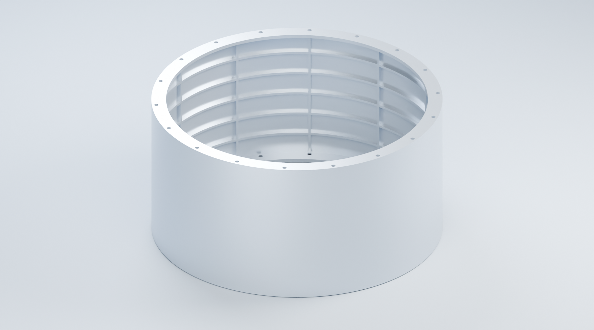

# CAStudio

> 本目录是 CoServe AI 仓库（`coserve-agent`）内的 CAStudio 服务工作树：打包时由 `apps/desktop/scripts/prepare-castudio.ts` 安装并构建，再暂存到应用的 `resources/castudio`。它自带 `package-lock.json` 与工具链，不属于 pnpm workspace；随附第三方组件的许可见 [THIRD_PARTY_NOTICES.md](THIRD_PARTY_NOTICES.md)。

## DSH 桌面集成

桌面端使用 DSH 原生对话和 harness，CAStudio 提供右侧 CAD、文件、编辑器、构建和仿真界面。`GET /api/dsh/projects` 返回真实项目目录；`POST /api/dsh/projects/:id/prepare` 保留已有 AGENTS.md 并准备 `.agents/skills`，供 DSH 原生工具使用。嵌入地址加上 `embedded=1&harness=dsh` 后不加载 Pi 聊天或模型设置。DeepSeek 凭据和会话由 DSH 管理；原有独立启动模式及历史文件保留。

本地 AI CAD 与结构仿真工作台。通过对话、参数化源码和三维视图构建模型，在同一项目中完成 CAD 发布、结构分析、结果查看与 Word 报告导出。

## 主要功能

- **统一工作台**：浅色界面，模型、参数化建模、结构分析和热分析独立工作区；可收起的设计助手与文件面板。
- **AI 对话与执行**：工具调用、流式日志、取消任务；连续命令默认折叠为一组，展开后查看详细输入和输出。
- **参数化建模**：Python notebook、步骤缓存、参数调整、实体/面/边/顶点选择、源码关联，以及 STEP 和场景包发布。
- **三维检查**：STEP/STP、STL、OBJ、GLB/GLTF 与结构化场景包；模型树、显隐、剖切、拆分、参考模型对比和截图。
- **圆柱对象编辑**：蒙皮、两端框、12 根纵筋和 5 道环筋可单独选择与改参；保留稳定对象 ID，支持三维视图联动、版本冲突检查与过期发布提示。
- **几何选择**：STEP 来源面整体高亮；同目录同名 STL/STEP 优先预览 STEP。STL 仅含显示网格时提供三角面选择，不自动恢复 CAD 特征。
- **CAD 实体检查**：直接读取 STEP/STP，计算材料并集体积、表面积、质心与包围盒；按自定义密度估算质量，并比较两个版本实际增加或减少的材料，支持差异实体预览与检查 JSON 导出。
- **项目管理**：文件编辑、构建记录、参数校验、项目快照、差异比较、恢复、几何批注及网格检查。
- **圆柱结构分析**：线性静力、特征值屈曲、几何非线性弹性分析、网格收敛研究和高应力诊断；显示 Mises 应力、位移、变形倍率及实际达到的载荷比例。
- **报告**：Word 报告包含模型参数、材料假设、载荷、计算结果、收敛状态及适用的 Blender CAD 渲染图；可下载报告、场数据和求解输入文件。

## 快速启动

需要 Node.js 22.19 或更新版本。以下命令启动工作台；CAD 与求解环境需另行配置。

~~~sh
npm ci
npm run build
npm start
~~~

打开 <http://127.0.0.1:4317>。开发模式使用 `npm run dev`；Windows 也可运行 `start.ps1`。

在「模型设置」中连接模型服务。支持 API Key、兼容接口或可用的账号登录通道；实际模型权限以服务响应为准。配置项见 [.env.example](.env.example)。本地服务默认仅监听回环地址。

**参数化编辑器与结构分析的安装步骤见 [运行环境配置](docs/runtime.md)。** Python 依赖、编辑器前端和 CalculiX 不会随 `npm ci` 自动安装；参数化 CAD 环境也可由 `scripts/setup-cad-env.mjs` 一键安装（可选，约 1.1 GB，需联网）。

## 加筋圆柱示例

在模型工作区打开「圆柱对象」，创建默认圆柱。在对象列表或三维视图中选择蒙皮、端框、纵筋或环筋，修改该对象的尺寸与位置，保存后重建 CAD。构建成功后可打开独立对象预览，再使用发布的计算实体运行结构分析、查看云图并下载 Word 报告。

对象编辑会同步更新 CAD 与壳网格参数，各构件分别使用其当前截面。每次发布保留独立目录；保存新参数后，旧发布会标记为过期，必须重新构建才能从对象面板启动分析。原有 Python notebook 建模入口仍可使用。

| 项目 | 示例设置 |
| --- | --- |
| 外径 / 总高 | 1000 / 500 mm，总高含两端翻边 |
| 蒙皮 | 2.5 mm |
| 端框翻边 | 向内径向宽 50 mm，两端各厚 12 mm |
| 螺栓孔 | 每端 18 × Ø15 mm，分布圆 Ø970 mm |
| 加筋 | 内侧 12 根纵筋、5 道环筋，截面 8 × 12 mm |
| 材料 | 假设线弹性铝合金，E = 70000 MPa，ν = 0.33，一体连接 |
| 边界与载荷 | 一端固定，另一端轴压 2451662.5 N（250 公吨力），筒体外压 0.2 MPa |
| 网格验证 | 默认 32 / 24 / 18 mm；仅在相同载荷水平比较 |

图片为 CAD 展示渲染，仿真云图由实际求解结果生成。

### 分析范围

当前工作台结构流程使用经过校验的圆柱壳理想化，支持固定 20 个构件的尺寸与位置变化。CAD 发布与计算启动都会按同一对象参数独立重建实体，复核源文件、双向实体差异和三组载荷边界，然后生成当前几何的网格。任意导入模型、增删构件或其他拓扑不自动适用于这条圆柱分析流程。

几何非线性分析沿用弹性材料，不包含塑性、初始缺陷、接触或螺栓预紧。报告生成成功不等于达到完整载荷或网格收敛：界面和报告保留实际载荷比例、求解状态及网格变化。超过材料适用范围的弹性应力不能作为强度合格结论。

对象预览保留 20 个可选择构件，计算实体采用一体连接。新建圆柱对象的 ID 可跨重建保持；普通导入的融合实体不自动恢复对象。STEP 面编号仍只对应当前文件，变更模型后应重新核实面批注。

## 日常工作流

1. 创建项目，导入模型或通过设计助手生成源码。
2. 在三维视图检查部件；在参数化工作区调整参数和建模步骤。
3. 在「几何检查与对比」中检查 CAD 实体，按需选择当前文件或已加载的历史参考，比较材料变化；发布经过校验的 CAD，运行受支持的分析。
4. 检查载荷完成度、力平衡、应力与位移结果，再导出报告。
5. 使用项目历史比较和恢复版本；恢复前自动保留当前成果。

源码构建在项目快照副本中执行，可查看日志、取消并发布成功产物。该执行目录不是操作系统沙箱。项目数据保存在 `.studio/`，可通过 `STUDIO_DATA_DIR` 更改；凭据、运行记录、缓存和本机分析结果不随源码仓库提交。

热分析使用独立运行环境，相关操作说明位于 `resources/thermal-sim/`；圆柱示例验证的是结构分析流程。

## 视口桥接（AI 代理接口）

打开的 CAD 工作台页面会向服务端上报实时三维视口状态，并执行一组白名单指令，供 AI 代理查看和操作视口。状态在界面变化时上报并每 5 秒心跳一次；`connected` 表示 20 秒内收到过上报。纯鼠标旋转视角不触发界面状态变化，状态里的相机位置最长可能滞后约 5 秒。

- `GET /api/projects/:id/viewport/state` → `{ connected, ageMs, state }`；`state` 包含工作区、模型状态、网格列表（最多 500 项）、当前选择、显示选项和相机。
- `POST /api/projects/:id/viewport/command` → 白名单指令：`fit`（视角）、`select` / `select_face`（选择网格或 CAD 面）、`visible`（显隐）、`options`（边线/网格/正交/剖切/拆分/选择模式）、`workspace`（切换工作区）、`snapshot`（视口截图）。工作台未打开时返回 409，页面 10 秒无响应返回 504，参数非法或页面执行失败返回 422。
- `GET /api/dsh/viewports` → 当前已连接（20 秒内有上报）的全部工作台，按最近上报时间倒序：`[{ id, name, workspacePath, ageMs, state }]`，`state` 为完整视口状态；未连接的项目不出现，供代理一次获取所有打开的工作台。
- `snapshot` 指令把当前视口渲染为 PNG，写入项目 `artifacts/viewport/viewport-<UTC 时间戳>.png`，每个项目仅保留最新 10 张；响应返回工作区相对路径 `path`、绝对路径 `absolutePath`、字节数和宽高，可通过 `GET /api/projects/:id/file?path=<path>` 读取。

视口状态与指令结果由打开的页面执行，服务端只负责转发、超时判定和截图落盘；状态只保存在内存中、不落盘，服务重启后需页面重新上报。关闭页面后 `connected` 在 20 秒内变为 false，此时应请用户打开 CAD 工作台标签页。多窗口同时打开时指令结果采用先到先得；接口沿用现有回环地址与来源检查，无额外身份验证。生成到项目 `.agents/skills/castudio/SKILL.md` 的技能文档包含全部指令的请求示例。

## 开发与验证

~~~sh
npm test
npm run build
~~~

Python 几何、结果解析和网格研究回归，以及内嵌编辑器的构建命令，见 [运行环境配置](docs/runtime.md)。对象改参的实际验证见 [圆柱对象验证记录](docs/objects-validation.md)。模型服务集成测试使用本地协议夹具，不需要真实账号；不代表线上模型权限验证。

| 目录 | 内容 |
| --- | --- |
| `src/` | 工作台、对话、三维视图和分析界面 |
| `server/` | 项目 API、执行任务、参数化服务和结果读取 |
| `resources/parametric/` | 圆柱模板、CAD 发布与语义边界校验 |
| `resources/structural-sim/` | 结构求解、结果解析、报告及回归测试 |
| `resources/cadflow-wheel/` | 官方 CadFlow 0.2.0 Windows wheel（原生 `cadflow_core.dll` + OCCT 7.9.3） |
| `resources/castudio-runtime/` | 参数化运行时与内嵌编辑器（改编自 SimpleCADAPI） |
| `tests/` | 工作台自动化测试 |
| `docs/` | 安装与配置说明 |

随源码分发的依赖保留各自的许可证、版权和必要声明，参见 [第三方声明](THIRD_PARTY_NOTICES.md)。
